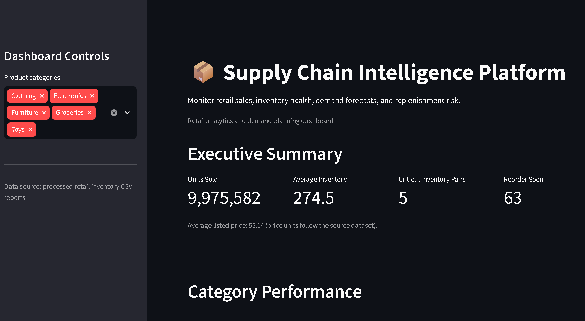

# Supply Chain Intelligence Platform

An end-to-end retail analytics project for demand forecasting, inventory risk monitoring, SQL-based business reporting, and interactive supply chain visualization.

## Overview

Retail businesses need to balance inventory availability against the risk of holding too much stock. This project transforms retail inventory data into actionable insights through a reproducible Python data pipeline, SQL analytics, forecasting benchmarks, and a Streamlit dashboard.
## Dashboard Preview


**Project status:** Core data processing, analytics, forecasting benchmarks, inventory risk assessment, and dashboard development completed.

## Key Features

- **Data quality:** Validate required fields, identify data issues, remove exact duplicates, and handle invalid demand forecasts.
- **SQL analytics:** Aggregate retail performance by category and date.
- **Demand forecasting:** Compare a previous-day baseline against a 7-day moving-average forecast.
- **Inventory risk monitoring:** Classify the latest store-product records into Critical, Reorder soon, Healthy, Forecast unavailable, and Data issue categories.
- **Interactive dashboard:** Explore category performance, daily sales, forecast accuracy, and inventory risk using Streamlit and Plotly.
- **Automated tests:** Verify important data-cleaning behavior with pytest.

## Technology Stack

- Python, pandas, NumPy
- SQL and SQLite
- Plotly and Streamlit
- pytest
- Jupyter Notebook

## Forecasting Results

The models were evaluated using a chronological 80/20 train-test split on daily aggregate unit sales.

| Forecast method | MAE | RMSE |
|---|---:|---:|
| Previous-day baseline | 1,177.33 | 1,483.99 |
| 7-day moving average | 893.70 | 1,129.55 |

The 7-day moving average reduced MAE by approximately 24.1% and RMSE by approximately 23.9% compared with the previous-day baseline on this test period.

These are results on a synthetic retail dataset, not a guarantee of real-world forecasting performance.

## Project Structure

```text
supply-chain-intelligence/
├── app/
│   └── dashboard.py
├── data/
│   ├── raw/
│   ├── processed/
│   └── sample/
├── notebooks/
├── sql/
│   └── marts/
├── src/
│   └── supply_chain/
│       ├── forecasting/
│       ├── inventory/
│       └── validation/
├── tests/
├── clean_pipeline.py
├── forecast_baseline.py
├── forecast_moving_average.py
├── build_inventory_risk_report.py
├── run_daily_report.py
├── run_sql_report.py
└── requirements.txt
```

## Setup

Use Python 3.10 or a compatible version supported by the listed dependencies.

Create and activate a virtual environment:

```powershell
python -m venv .venv
.\.venv\Scripts\Activate.ps1
python -m pip install -r requirements.txt
```

## Dataset

This project uses a synthetic retail store inventory dataset from Kaggle:

https://www.kaggle.com/datasets/anirudhchauhan/retail-store-inventory-forecasting-dataset

Download `retail_store_inventory.csv` and place it in `data/raw/`.

The raw dataset and generated SQLite database are excluded from version control. Follow the dataset's license and attribution requirements when redistributing or using the data.

## Running the Project

Run commands from the project root.

1. Validate the raw data:

```powershell
python check_data.py
```

2. Clean the data:

```powershell
python clean_pipeline.py
```

3. Generate the forecasting evaluations:

```powershell
python forecast_baseline.py
python forecast_moving_average.py
```

4. Generate the inventory risk report:

```powershell
python build_inventory_risk_report.py
```

5. Generate the SQL reports using the project's database/report pipeline:

```powershell
python run_sql_report.py
python run_daily_report.py
```

6. Launch the dashboard:

```powershell
python -m streamlit run app/dashboard.py
```

Some report-generation steps require the processed data and SQLite database to have been created first.

## Tests

Run the automated tests:

```powershell
python -m pytest -v
```

## Limitations

- The dataset is synthetic and may not represent real retail demand patterns.
- Forecasting models are simple benchmarks, not production-grade forecasting systems.
- Inventory risk classifications depend on available inventory and demand forecast values.
- Real-world deployment would require validation on actual operational data and business-specific replenishment rules.

## Future Improvements

- Add seasonal forecasting models and stronger out-of-sample evaluation.
- Introduce configurable lead times, safety stock, and reorder-point calculations.
- Add automated pipeline orchestration and data-quality monitoring.
- Deploy the dashboard and add screenshots to the project documentation.
